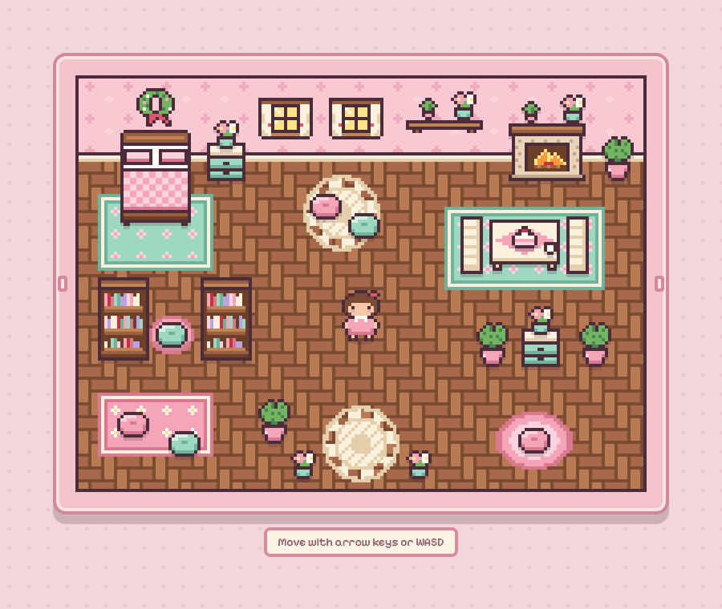

# Hub World Game

A cozy pixel-art cottage you can walk around in. Each piece of furniture can
hide a mini-game: sit down at the tea table for a game of chess, pick a book
for hangman, and more.



## Controls
| Key | Action |
| --- | --- |
| Arrow keys / WASD | Walk |
| E | Interact with the object you're standing next to |
| Esc | Leave a mini-game and return to the room |

## Mini-games
| Game | Status |
| --- | --- |
| Tic-tac-toe | Planned: board and a simple computer opponent |
| Hangman | Planned: word list, guessing and the hangman drawing |
| Chess | Planned: full rules via python-chess and a simple AI |

More games can be added later. Each one is a folder in `games/` plus an
object in the room.

## Quick start
```bash
python3 -m venv .venv
source .venv/bin/activate
pip install -r requirements.txt
python app.py
```
Open http://127.0.0.1:5050.

See [SETUP.md](SETUP.md) for details, tests and the project structure.

## Tech stack
- **Python + Flask** serve the room and the mini-games.
- **HTML + CSS** for everything you see. All colors and fonts are variables
  in `static/css/theme.css`.
- **JavaScript** for walking around, keyboard input, sounds and sending moves
  without reloading the page. The game rules themselves are in Python.
- **python-chess** handles the chess rules.
- **Pixel art** is drawn in code: each sprite is a grid of letters in
  `room/sprites.py`, rendered as SVG.

## How the project is organized
- `main` holds the stable game.
- `room` holds the hub world, and each game has its own branch (`game/chess`,
  `game/hangman`, `game/tictactoe`).
- All work starts as a GitHub issue, gets its own branch, and comes back as a
  pull request into its parent branch.

The full rules, including the art style, are in [CLAUDE.md](CLAUDE.md).

## Credits
- Font: [Pixelify Sans](https://github.com/eifetx/Pixelify-Sans), SIL Open
  Font License 1.1.
- All pixel art is original. The images in `docs/aesthetic/` are mood
  references only.
